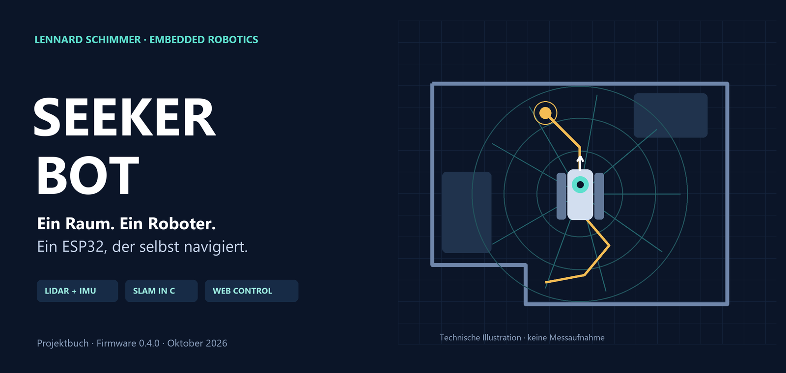

# Seeker Bot



**Autonome Raumerkundung auf einem ESP32.** LiDAR und Gyroskop liefern die Umgebung, eine eigene SLAM-Implementierung baut die Karte, und der Roboter navigiert zu erreichbaren Zielen. Die Bedienung erfolgt im lokalen Browser.

**Autor:** Lennard Schimmer · **Firmware:** 0.4.0 · **Status:** Entwicklungsprojekt mit Host-Regressionen; reale Langzeitabnahme des aktuellen Stands steht aus.

[Projektbuch lesen](docs/PROJEKTBUCH.md) · [Einrichten](docs/GETTING_STARTED.md) · [Verkabelung](docs/WIRING.md) · [API](docs/API.md) · [Fehlersuche](docs/TROUBLESHOOTING.md)

## Was steckt darin?

- **Lokale Kartierung:** Scan Matching in C, 256 × 256 Zellen mit 5 cm Auflösung; keine Radencoder und kein externer Rechner für die Navigation.
- **Sensorfusion:** MPU6050-Gyroskop, zeitbezogene Scanentzerrung und Qualitätsprüfung der Positionsschätzung.
- **Mehrere Fahrstrategien:** Exploration, Wandfolge, Bug2-Zielnavigation und Kartenpfade per Breitensuche.
- **Patrouillenrouten:** Geschlossene Rundkurse auf der Karte zeichnen und 1…n-mal oder bis zum Stopp abfahren; gestartet wird nur über bekannt freiem Korridor.
- **Körpergerechte Freiraumprüfung:** 19 Fahrkorridore, Rückraum und überstrichener Drehkörper.
- **Begrenzte Kurskorrektur:** Kurze Impulse und frische Rückmeldung gegen unnötiges Pendeln.
- **Integriertes Dashboard:** Steuerung, Radar, Karte, Einstellungen, Diagnose und OTA; keine externen Laufzeitdateien.
- **Reproduzierbare Fehlersuche:** Reset-Historie, Speicherdiagnose und Sensordatenaufzeichnung mit Offline-SLAM-Replay.


## Schnellstart

Benötigt werden ein ESP32 mit 4 MB Flash, LD20, L298N und das passende Chassis. Ein MPU6050 wird besonders für Drehungen empfohlen. Das konkrete Chassis verwendet eine Fahrtachse und eine Drehachse; ein gewöhnlicher Differentialantrieb erfordert eine Anpassung.

Mit PlatformIO in der Repository-Wurzel:

```powershell
Copy-Item src/credentials.example.h src/credentials.h
# WLAN-Zugangsdaten ausschließlich in src/credentials.h eintragen.
pio run -e seeker_bot
pio device list
pio run -e seeker_bot -t upload --upload-port PORT
pio device monitor --port PORT --baud 115200
```

Linux/macOS: Die erste Zeile durch `cp src/credentials.example.h src/credentials.h` ersetzen. `PORT` ist der Anschluss des eigenen ESP32. Anschließend `http://ROBOTER_IP` mit der im seriellen Log angezeigten Adresse öffnen. Erst die Motorachsen angehoben prüfen und die Sensorausrichtung bestätigen; dann die Inbetriebnahme im Dashboard freigeben. Die [Einrichtungsanleitung](docs/GETTING_STARTED.md) beschreibt alle Schritte.

`credentials.h` bleibt lokal. Auch selbst gebaute Firmware enthält die einkompilierten Zugangsdaten und gehört nicht in ein öffentliches Release.

## Dokumentation

| Einstieg | Inhalt |
|---|---|
| [Projektbuch](docs/PROJEKTBUCH.md) | Idee, Besonderheiten, Hardware, Algorithmen, Schutzmaßnahmen und Grenzen; für Markdown-zu-PDF vorbereitet |
| [Einrichtung](docs/GETTING_STARTED.md) | Werkzeuge, USB-Flash, Bedienung, OTA und Aufzeichnung |
| [Verkabelung](docs/WIRING.md) | GPIOs, Motorachsen, LiDAR, IMU und Versorgung |
| [Architektur](docs/ARCHITECTURE.md) | Module, Aufgaben, Zeitbezüge und Speicherlayout |
| [API](docs/API.md) | HTTP-Endpunkte, Steuerbefehle, Status und binäres Kartenformat |
| [Tests](docs/TESTING.md) | Lokale Regressionen, Replay und reale Fahrabnahme |
| [Fehlersuche](docs/TROUBLESHOOTING.md) | Verbindungsabbrüche, Drift, LiDAR und pendelnde Fahrt |
| [Veröffentlichung](docs/PUBLICATION.md) | Bereinigung, Quelltextexport und noch offene Freigaben |

## Entwickeln und prüfen

Python, Node.js und GCC müssen für die hardwarefreien Tests im Suchpfad liegen:

```sh
python tools/run_host_tests.py
python tools/check_publication.py
pio run -e seeker_bot
```

Die Host-Suite benötigt weder Roboter noch WLAN-Zugangsdaten. Sie umfasst 10 C- und 7 JavaScript-Testprogramme. Die mitgelieferte GitHub-Actions-Konfiguration führt die Prüfungen und einen Firmwarebau mit Platzhalter-Zugangsdaten aus. Ein GitHub-CI-Ergebnis wird erst nach Veröffentlichung verfügbar.

## Aktueller Umfang

Seeker Bot verwendet eine feste lokale Karte und besitzt keine globale Schleifenschließung, persistente Raumkarte, Absturzerkennung oder Ladestationserkennung. Schlechte Oberflächen, strukturarme Szenen und schnelle Bewegung bleiben anspruchsvoll. Die erfolgreichen synthetischen Tests sind keine Zusage einer bestimmten Genauigkeit auf realen Böden.

Die Netzwerkschnittstelle ist für ein vertrauenswürdiges lokales Netzwerk vorgesehen. Controller-Lease und Origin-Prüfung sind keine Benutzeranmeldung. Näheres steht in [SECURITY.md](SECURITY.md).

## Mitwirken und Lizenz

Fehlerberichte mit Firmwarestand und reproduzierbaren Schritten sind willkommen. [CONTRIBUTING.md](CONTRIBUTING.md) beschreibt den Prüfablauf; [CHANGELOG.md](CHANGELOG.md) trennt die aktuellen Änderungen nach Version.

Seeker Bot steht unter der [MIT-Lizenz](LICENSE). Drittanbieter behalten ihre jeweiligen Lizenzen; siehe [THIRD_PARTY_NOTICES.md](THIRD_PARTY_NOTICES.md).
