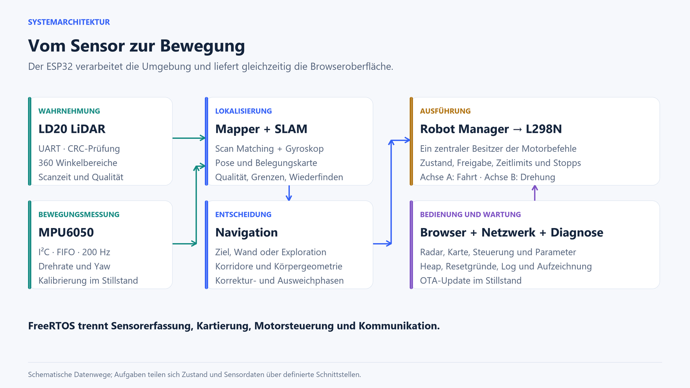

# Architektur

## Module und Zuständigkeiten

| Bereich | Dateien | Verantwortung |
|---|---|---|
| Start | `src/main.c` | Initialisierung; kein automatischer Fahrtstart |
| Pins und Defaults | `components/seeker_config/include/seeker_pins.h` | Zentrale Hardwareannahmen |
| LiDAR | `components/ld20_lidar/` | UART, Paketprüfung und Veröffentlichung abgeschlossener Umläufe |
| IMU | `src/imu.c` | FIFO, Kalibrierung, Yaw-Zeitverlauf und Sensorfrische |
| SLAM | `src/slam.c`, `src/slam.h` | Reines C: Scan Matching, Karte, Qualitätsprüfung und Rasterpfade |
| Mapper | `src/mapper.c` | SLAM-Aufgabe, IMU-Zeitzuordnung, Ziele und Recorder |
| Navigation | `src/navigation.c` | Reines C: Korridore, Strategien und Manöver |
| Pose-Feedback | `src/pose_feedback.h` | Frische Weltorientierung aus Kartenpose und Gyroskopreferenz |
| Robot Manager | `src/robot_manager.c` | Einzige Anwendungsinstanz für Motorbefehle, Zustände und Freigaben |
| Motortreiber | `components/track_drive/` | H-Brücken, PWM und verriegelter Stopp |
| Netzwerk | `src/network.c` | WLAN-Ereignisse und Wiederverbindung |
| Web | `src/web_server.c`, `src/web/index.html` | HTTP, Dashboard, Steuerprotokoll und OTA |
| Diagnose | `src/diag.c` | RTC-Log, NVS-Historie und Allokationsfehler |

## Aufgaben und Zeitbezüge

| Aufgabe | Priorität im Quelltext | Zuordnung | Aufgabe im Betrieb |
|---|---:|---|---|
| Robot Manager | 8 | Nicht fest an einen Core gebunden | 20-ms-Steuerzyklus |
| LiDAR-Empfang | 7 | Nicht fest gebunden | UART kontinuierlich verarbeiten |
| IMU | 5 | Core 1 | 200-Hz-FIFO-Daten abholen |
| Mapper | 4 | Core 1 | Neue LiDAR-Scans verarbeiten |
| HTTP-Server | Standard 5 | Nicht fest gebunden | Requests sequenziell bearbeiten |
| WLAN-Supervisor | 3 | Nicht fest gebunden | Wiederverbindung überwachen |

SDK-interne Aufgaben kommen hinzu. Insbesondere ist die WLAN-Treiberaufgabe auf Core 0 konfiguriert. Die Tabelle beschreibt den aktuellen Code und keine allgemeine Garantie einer bestimmten CPU-Auslastung.

Eine Scan-Sequenz kennzeichnet eine neue vollständige Beobachtung. Zeitstempel stammen aus der Mikrosekunden-Zeitbasis des ESP32. Der Mapper veröffentlicht die Scanpose zusammen mit einer Gyroskopreferenz. Ein IMU-Neustart beziehungsweise eine neue Kalibrierung verändert die Referenzepoche; Werte verschiedener Epochen dürfen nicht zu einer Drehratenkorrektur kombiniert werden.

Der Robot Manager liest Mapper-Informationen vor dem eigenen Lock. Motorbefehle laufen zentral zusammen. Die statischen SLAM-Planungsarbeitsbereiche sind nicht reentrant; die aufrufende Mapper-Logik muss ihre gemeinsame Nutzung ordnen.

## Einheiten und Koordinaten

| Schnittstelle | Konvention |
|---|---|
| Welt / SLAM | x anfänglich vorwärts, y links, theta gegen den Uhrzeigersinn |
| Position | Millimeter |
| SLAM-Winkel / Drehrate | Radiant / Radiant pro Sekunde |
| Statuswinkel | `poseDeg` in Grad |
| Lokaler Roboterwinkel | 0° vorne, positive Winkel rechts |
| Motorachsen | Positive Fahrt vorwärts, positive Drehung rechts |
| Webscan | Index 0 vorne; Index wächst nach rechts |
| LiDAR-Rohwinkel | Standard: 180° vorne, Uhrzeigersinn |
| Gespeicherte / übertragene Fahrspur | Vorzeichenbehaftete Zentimeter |

## Karte und Planer

Die Karte enthält 256 × 256 `int8_t`-Log-Odds-Zellen mit 50 mm Auflösung. Der Ursprung liegt bei Zelle 128/128. Eine 32 × 32 große Besuchsmatrix fasst jeweils 40-cm-Bereiche zusammen. Der Planer arbeitet mit 64 × 64 Zellen à 20 cm. Die Fahrspur enthält höchstens 1024 x/y-Paare.

Neue Karteneinträge setzen passende Qualität und begrenzte Drehbewegung voraus. Verlorene oder mehrdeutige Positionsschätzungen dürfen die Translation nicht unbestätigt fortschreiben. Die lokale Navigation bleibt für aktuelle Hindernisse zuständig, auch wenn ein Rasterpfad existiert.

## Flash und RAM

| Partition | Offset | Größe | Zweck |
|---|---|---|---|
| `nvs` | `0x9000` | `0x6000` | Einstellungen und Diagnosehistorie |
| `otadata` | `0xf000` | `0x2000` | Bootauswahl |
| `phy_init` | `0x11000` | `0x1000` | Funkdaten |
| `ota_0` | `0x20000` | `0x1e0000` | Anwendungsslot |
| `ota_1` | `0x200000` | `0x1e0000` | Anwendungsslot |

Jeder Anwendungsslot umfasst 1,875 MiB. Der Recorder verwendet den jeweils inaktiven Slot. Eine Aufnahme entfernt damit dessen vorherigen Inhalt; OTA entfernt eine dort liegende Aufnahme.

Große feste Daten liegen in statischen Bereichen. Das Dashboard ist als gzip-Asset im Flash eingebettet. Der HTTP-Server verwendet einen gemeinsamen 7168-Byte-Scratch-Puffer; seine Handler laufen auf derselben Serveraufgabe. Die RLE-Kodierung verwendet diesen Puffer, statt eine zusätzliche große Heap-Allokation anzulegen.

Weitere Erklärung: [Projektbuch](PROJEKTBUCH.md). Datenformate: [API](API.md).
