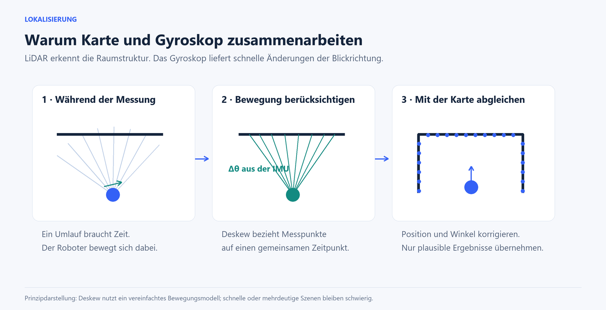
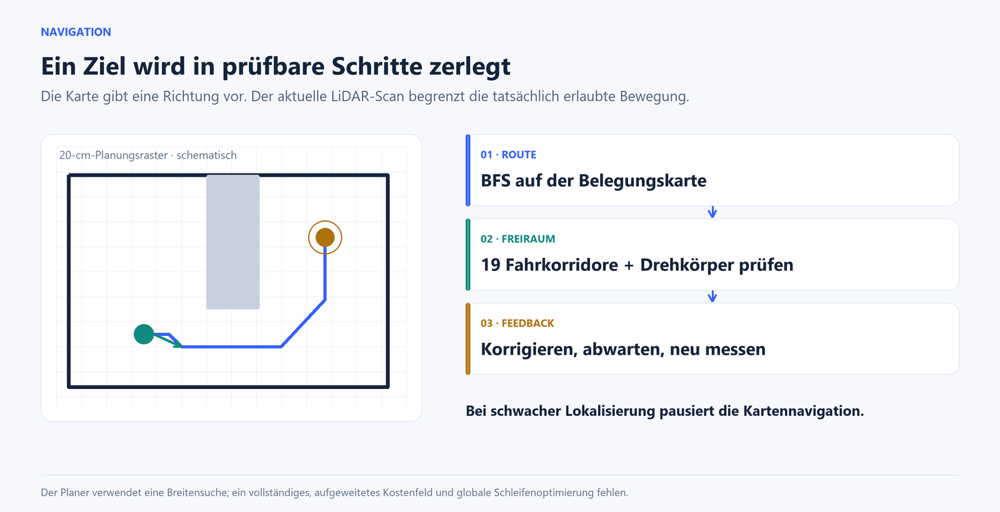
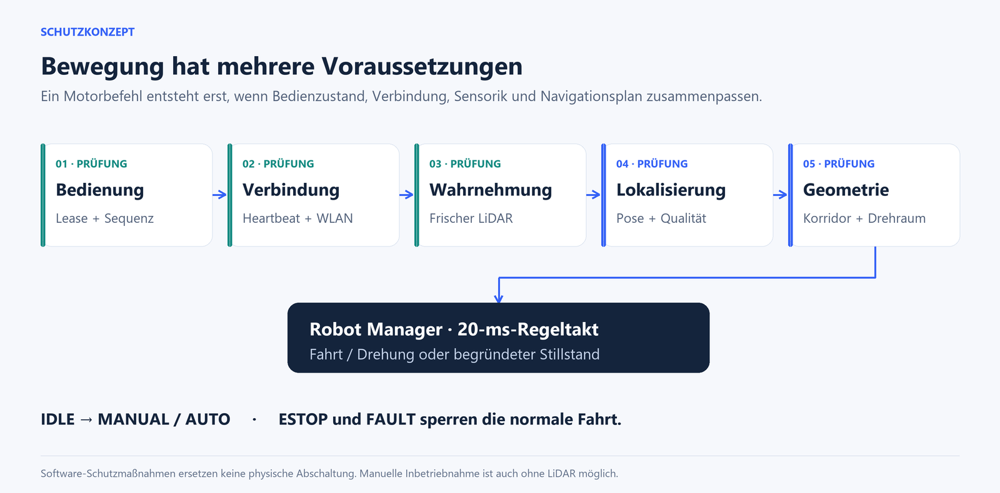

# Seeker Bot


**Ein autonomer Kettenroboter, der seine Umgebung selbst vermisst, eine Karte aufbaut und daraus Bewegungen ableitet.**

Projektbuch von **Lennard Schimmer**  
Firmwarestand **0.4.0** · Dokumentationsstand **15. Oktober 2026**

> Seeker Bot verbindet Robotik, Echtzeitsoftware und eine lokale Weboberfläche auf einem ESP32. Sein Reiz liegt in der vollständigen Verarbeitungskette: Aus einzelnen Laserabständen entsteht eine räumliche Vorstellung, aus dieser Vorstellung ein Weg und aus dem Weg eine kontrollierte Bewegung.

Dieses Projektbuch führt von der Idee bis zu den Entscheidungen im Code. Es richtet sich an Menschen, die das Projekt kennenlernen, nachbauen oder weiterentwickeln möchten. Die Abbildungen sind technische Illustrationen; sie zeigen keine gemessenen Fahrten und keine fotografische Darstellung des konkreten Chassis.

---

## Inhalt

1. [Die Idee](#1-die-idee)
2. [Was Seeker Bot besonders macht](#2-was-seeker-bot-besonders-macht)
3. [Das System auf einen Blick](#3-das-system-auf-einen-blick)
4. [Hardware und Mechanik](#4-hardware-und-mechanik)
5. [Vom Laserpunkt zum verwertbaren Scan](#5-vom-laserpunkt-zum-verwertbaren-scan)
6. [Wie der Roboter seine Position bestimmt](#6-wie-der-roboter-seine-position-bestimmt)
7. [Wie eine Karte entsteht](#7-wie-eine-karte-entsteht)
8. [Wie aus einer Karte Bewegung wird](#8-wie-aus-einer-karte-bewegung-wird)
9. [Warum die Fahrt ruhiger werden soll](#9-warum-die-fahrt-ruhiger-werden-soll)
10. [Schutzmaßnahmen und Betriebszustände](#10-schutzmaßnahmen-und-betriebszustände)
11. [Die Browseroberfläche](#11-die-browseroberfläche)
12. [Echtzeit, Speicher und Verbindung](#12-echtzeit-speicher-und-verbindung)
13. [Diagnose statt Rätselraten](#13-diagnose-statt-rätselraten)
14. [Einrichtung und erste Fahrt](#14-einrichtung-und-erste-fahrt)
15. [Softwareaufbau und Weiterentwicklung](#15-softwareaufbau-und-weiterentwicklung)
16. [Was bereits geprüft wurde](#16-was-bereits-geprüft-wurde)
17. [Grenzen und nächste Entwicklungsschritte](#17-grenzen-und-nächste-entwicklungsschritte)
18. [Projektangaben, Begriffe und Quellen](#18-projektangaben-begriffe-und-quellen)

---

## 1. Die Idee

Ein Roboter, der auf einen Knopfdruck losfährt, ist schnell gebaut. Schwieriger wird es, wenn er verstehen soll, wo er ist, welche Richtung frei ist und ob seiner eigenen Positionsschätzung noch zu trauen ist.

Genau hier setzt Seeker Bot an. Der Roboter schaut mit einem rotierenden LiDAR in den Raum. Ein Gyroskop ergänzt die Messung seiner Drehbewegung. Die Firmware vergleicht neue Scans mit einer selbst aufgebauten Karte und schätzt daraus Position und Orientierung. Auf dieser Grundlage kann sie unbekannte Bereiche erkunden, einer Wand folgen oder ein Ziel in der Karte anfahren.

All das geschieht auf dem ESP32 des Roboters. Ein Smartphone oder Computer dient als Bediengerät: Der Browser zeigt Radar, Karte, Betriebszustand und Diagnosewerte. Die eigentliche Kartierung und Navigation laufen auf dem Mikrocontroller; der Browser berechnet keine Fahrwege.

Die Entwicklung ist von realen Problemen geprägt. Dazu gehören fehleranfällige LiDAR-Daten, ein scheinbar aus dem Raum driftender Roboter, pendelnde Kurskorrekturen und Verbindungsabbrüche nach zunächst erfolgreichen Fahrten. Aus diesen Beobachtungen sind konkrete Mechanismen entstanden: vollständige Scans statt zeitlich vermischter Messungen, eine Prüfung der räumlichen Plausibilität, kurze Rückmeldeschleifen beim Lenken und ein bewusster Umgang mit knappem Arbeitsspeicher.

**Das Ziel ist nachvollziehbare Autonomie:** Der Roboter soll sich bewegen können, aber ebenso erkennen, wann ihm die Grundlage für die nächste Bewegung fehlt.

## 2. Was Seeker Bot besonders macht

### 2.1 Eine vollständige Robotik-Verarbeitungskette auf kleinem Rechner

Seeker Bot führt Sensorerfassung, Scan Matching, Kartierung, Wegplanung, Motorsteuerung, WLAN und Webserver auf einem ESP32 zusammen. Für den Betrieb ist kein zusätzlicher Einplatinencomputer vorgesehen. Das zwingt zu klaren Schnittstellen und sparsamen Datenformaten – und macht die technischen Entscheidungen unmittelbar sichtbar.

### 2.2 Orientierung ohne Radencoder

Die Positionsschätzung verwendet Laserstruktur und Gyroskop. Die Firmware erhält keine gemessenen Radwege. Das ist bei einem Kettenfahrzeug mit Schlupf interessant: Eine drehende Kette beweist noch keinen entsprechenden Ortswechsel. Gleichzeitig fehlen dadurch verlässliche Bewegungsinformationen, wenn der Laser in einer strukturlosen oder mehrdeutigen Umgebung keine eindeutige Position bestimmen kann.

Die Antwort des Projekts darauf ist eine bewertete Schätzung. Qualität, Aktualität, plausible Bewegung und sichtbare Raumstruktur entscheiden darüber, ob die Karte weitergeschrieben und die Fahrt fortgesetzt werden dürfen.

### 2.3 Die Navigation berücksichtigt den Körper

Der Roboter ist größer als ein Laserstrahl. Seeker Bot untersucht deshalb Fahrkorridore mit Breite und berücksichtigt die Position des LiDAR innerhalb des Chassis. Auch beim Drehen zählt der überstrichene Raum der Karosserie.

Ein Hindernis neben der Mitte kann eine Geradeausfahrt erlauben und eine Drehung trotzdem blockieren. Diese Unterscheidung ist ein Kernstück der reaktiven Navigation.

### 2.4 Rückmeldung begrenzt Kurskorrekturen

Ein träger Motor, hohe Anfahrleistung und verspätete Messdaten können einen kleinen Richtungsfehler in eine Folge übergroßer Gegenkorrekturen verwandeln. Seeker Bot behandelt kleine Kursänderungen deshalb als begrenzte Impulse mit anschließender Beobachtung. Die Steuerung wartet auf neue Information, statt dieselbe alte Abweichung immer wieder zu korrigieren.

### 2.5 Die Bedienoberfläche gehört zur Firmware

Das Dashboard kommt direkt vom Roboter. HTML, CSS und JavaScript benötigen im Betrieb keine externen Schriften, CDN-Dateien oder Cloud-Dienste. Radar, Karte und Systemdaten bleiben im lokalen Netzwerk.

Die Oberfläche ist zugleich ein Diagnosewerkzeug. Wer eine Fahrt beobachtet, kann erkennen, ob der Roboter ein Hindernis sieht, seiner Position nicht mehr vertraut oder wegen einer unterbrochenen Bedienverbindung pausiert.

### 2.6 Fehler lassen sich untersuchen und nachstellen

Resetgründe, Speicherwerte und ein über bestimmte Neustarts erhaltener Logpuffer helfen bei der Fehlersuche. Zusätzlich kann der Roboter Sensoreingaben aufzeichnen. Dieselbe SLAM-Implementierung lässt sich anschließend auf einem Entwicklungsrechner mit diesen Daten erneut ausführen.

Das unterscheidet eine reproduzierbare Untersuchung von einer bloßen Beobachtung wie „diesmal ist er wieder abgedriftet“.

Diese Eigenschaften beschreiben die technische Kombination des Projekts. Sie sind kein Anspruch, ein weltweit einzigartiges Verfahren erfunden zu haben.

## 3. Das System auf einen Blick


*Abbildung 1: Sensoren liefern die Grundlage, die Navigation bewertet mögliche Bewegungen und der Robot Manager führt freigegebene Motorbefehle aus.*

| Baustein | Aufgabe | Ergebnis |
|---|---|---|
| LD20-Treiber | Datenstrom prüfen und Umläufe zusammensetzen | Zeitlich zusammengehöriger 360°-Scan |
| MPU6050-Treiber | Drehraten erfassen und kalibrieren | Drehrichtung, Yaw-Verlauf und Frische |
| Mapper / SLAM | Scan mit Raumkarte vergleichen | Position, Orientierung, Karte und Qualität |
| Navigation | Strategie und aktuellen Freiraum auswerten | Fahrt, Drehung oder begründeter Stillstand |
| Robot Manager | Zustand, Freigabe und Grenzwerte durchsetzen | Ein zentraler Motorbefehl |
| Webserver | Bedienung und Diagnose bereitstellen | Lokales Browser-Dashboard und API |
| Diagnose / Recorder | Fehlerkontext und Sensoreingaben sichern | Auswertbare Neustarts und Offline-Replays |

Ein typischer Ablauf beginnt mit einem neuen LiDAR-Umlauf. Der Mapper ordnet ihn räumlich ein. Die Navigation verbindet die globale Absicht – etwa ein Ziel im Raum – mit der aktuellen Hindernissituation. Der Robot Manager prüft die Voraussetzungen und setzt die Motorachsen. Gleichzeitig stellt der Webserver die Ergebnisse für den Browser bereit.

Die Aufgaben laufen unter FreeRTOS. Kartierung, Sensoren und Kommunikation können daher unterschiedlich oft arbeiten. Die Motorsteuerung besitzt einen eigenen 20-ms-Takt; sie wird nicht aus einer Browser-Zeichenroutine heraus angetrieben.

## 4. Hardware und Mechanik

### 4.1 Die Komponenten

| Komponente | Rolle im Projekt |
|---|---|
| ESP32, Zielkonfiguration `esp32dev` / WROOM-32 | Rechenplattform, WLAN, Echtzeitaufgaben |
| FHL-LD20 LiDAR | Rotierende Entfernungsmessung in einer Ebene |
| MPU6050 / GY-521 | Gyroskop und Beschleunigungssensor für die Ausrichtung |
| L298N | Zwei H-Brücken zur Motoransteuerung |
| Kettenchassis mit zwei Funktionsachsen | Fahrt und Drehung |
| Getrennte bzw. geeignete Versorgungen | Energie für Logik, Sensorik und Motoren |

Die Firmware ist für 4 MB Flash konfiguriert und setzt keine PSRAM-Erweiterung voraus. Die tatsächliche Versorgungsspannung der Motoren hängt vom verwendeten Chassis ab; sie wird nicht durch die Platinenbeschriftung des L298N festgelegt.

### 4.2 Die ungewöhnliche Antriebszuordnung

Das konkrete Chassis besitzt eine **Fahrtachse** und eine **Drehachse**. Motor A am L298N bewegt den Roboter vorwärts oder rückwärts. Motor B dreht ihn nach links oder rechts. Beide können gleichzeitig aktiv sein.

Diese Zuordnung muss bei Nachbauten erhalten oder bewusst angepasst werden. Ein Chassis mit zwei direkt angesteuerten Kettenseiten benötigt eine andere Umsetzung der Fahr- und Drehbefehle.

| Signal | GPIO | Funktion |
|---|---:|---|
| ENA | 25 | PWM der Fahrtachse |
| IN1 / IN2 | 26 / 27 | Richtung der Fahrtachse |
| ENB | 14 | PWM der Drehachse |
| IN3 / IN4 | 32 / 33 | Richtung der Drehachse |
| LiDAR TX → ESP32 RX | 18 | UART2-Empfang |
| IMU SDA / SCL | 21 / 22 | I²C |

Die zentrale Hardwaredefinition liegt in `components/seeker_config/include/seeker_pins.h`. Der Motortreiber verwendet 20 kHz PWM mit 10 Bit Auflösung. Die Software berücksichtigt eine Mindestleistung und einen Anfahrimpuls, weil das vorhandene Getriebe bei kleinen PWM-Werten nicht zuverlässig anläuft.

Die hinterlegten Mindestwerte von 85 % für Fahrt und 80 % für Drehung stammen vom konkreten Aufbau. Sie sind keine allgemeine Empfehlung für beliebige Motoren.

### 4.3 Die Geometrie ist Teil der Software

Der im Code hinterlegte Körper reicht von der LiDAR-Mitte 100 mm nach vorn, 200 mm nach hinten und je 70 mm zur Seite. Daraus ergibt sich eine Körpergröße von 300 × 140 mm. Der Standard-Fahrkorridor ist 200 mm breit und enthält damit eine seitliche Reserve.

Entscheidend ist der Bezugspunkt: Der Laser misst ab seiner eigenen Position. Ein Abstand vor dem Roboter muss deshalb um den vorderen Körperanteil korrigiert werden. Die in der Navigation verwendeten freien Fahrstrecken beziehen sich auf die Stoßkante des Körpers.

Die Drehprüfung nimmt eine Rotation um die Mitte des Körpers an. Diese Annahme muss zur tatsächlichen Mechanik passen.

### 4.4 Anschluss und Kalibrierung

Der LiDAR sendet mit 230400 Baud und 8N1. Die Firmware empfängt auf UART2; eine UART-Sendeleitung zum Sensor ist nicht erforderlich. Beim vorhandenen Kabelsatz sind Schwarz die 5-V-Versorgung, Grün Masse, Weiß die Datenleitung und Rot ein offen gelassener PWM-Eingang. Andere Chargen können abweichen. Ausschlaggebend bleibt die Steckerbelegung in den [LD20-Unterlagen](https://wiki.youyeetoo.com/en/Lidar/LD20).

Der MPU6050 wird über SDA 21 und SCL 22 eingebunden. Nach dem Einschalten bleibt der Roboter ungefähr zwei Sekunden ruhig. Die Firmware bestimmt den Gyroskop-Nullpunkt und verwendet die Schwerkraft zur Bestimmung der Hochachse. Eine beliebige feste Einbaulage wird dadurch berücksichtigt; eine während der Fahrt veränderte Sensorbefestigung ist damit nicht abgedeckt.

Die vollständige Anschlussanleitung steht in `docs/WIRING.md`.

## 5. Vom Laserpunkt zum verwertbaren Scan

### 5.1 Ein Datenpaket ist noch keine Umgebung

Der LiDAR liefert fortlaufend kleine UART-Pakete. Der Treiber sucht gültige Paketanfänge, prüft die CRC und verarbeitet die enthaltenen Entfernungs- und Intensitätswerte. Ein gültiges Paket enthält zwölf Messpunkte. Aus Start- und Endwinkel werden deren Winkelpositionen bestimmt.

Die Messwerte landen in 360 Winkelbereichen. Jeder Bereich entspricht einem Grad. Das ist die interne Rasterung der Firmware, keine Aussage über die optische Winkelgenauigkeit des Sensors.

### 5.2 Warum vollständige Umläufe wichtig sind

Wenn ein gerade gemessener Punkt mit einem deutlich älteren Punkt aus einer anderen Orientierung kombiniert wird, kann ein scheinbar vollständiger Scan entstehen, der räumlich nie existiert hat. Besonders während einer Drehung wird daraus eine verzerrte Wand – und später eine falsche Positionskorrektur.

Der Scan-Builder veröffentlicht deshalb abgeschlossene Umläufe mit Sequenznummer, Zeitbezug, Periodendauer und Messabdeckung. Paketlücken, Winkelübergänge, Neustarts und Erholung des Datenstroms gehören zu den geprüften Fällen.

### 5.3 Fehlende Messungen bleiben Unsicherheit

Die Software filtert unter anderem Werte außerhalb von 80 bis 8000 mm und zu schwache Intensitäten. Diese Grenzen beschreiben die Filtereinstellung des Projekts. Sie sind keine zugesicherte Reichweite auf jeder Oberfläche.

Ein fehlender Rücklauf kann mehrere Ursachen haben: Entfernung, dunkles Material, Reflexion, Abschattung oder Datenverlust. Er beweist keinen freien Raum. Die Navigation begrenzt daher überwiegend ungemessene Korridore und prüft, welche Bewegungsrichtungen überhaupt ausreichend beobachtet sind.

Isolierte Lücken dürfen im Stillstand vorsichtig mit dem vorherigen Scan ergänzt werden, wenn die aktuellen Nachbarwerte dazu passen. Während der Bewegung wird keine vollständige alte Rundumsicht in die neue hineingemischt.

### 5.4 Qualität ist mehr als „UART empfängt“

Für die autonome Freigabe zählen auch Messabdeckung und Alter. Im aktuellen Standard sind mindestens 180 gültig belegte Winkelbereiche erforderlich; ein Scan gilt nach 400 ms als veraltet. Die räumliche Eignung für SLAM wird zusätzlich geprüft.

So kann der Datenstrom technisch funktionieren, während eine konkrete Situation für zuverlässige Positionsschätzung trotzdem zu wenig Struktur bietet.

## 6. Wie der Roboter seine Position bestimmt

### 6.1 Pose: Ort und Blickrichtung

Die Firmware beschreibt die Roboterpose mit drei Größen: `x`, `y` und `theta`. `x` und `y` liegen in Millimetern vor, `theta` in Radiant. Der Startpunkt bildet den Ursprung der lokalen Weltkarte. Die anfängliche Fahrtrichtung ist positive x-Richtung; positive y-Richtung zeigt nach links. Positive Weltwinkel drehen gegen den Uhrzeigersinn.

Die Motor- und Roboteransicht verwendet positive Drehbefehle nach rechts. Die Umrechnung zwischen diesen Vorzeichen ist ausdrücklich Teil der Schnittstellen. Ein versehentlich vertauschtes Vorzeichen würde Karte, Radar und Lenkung gegeneinander arbeiten lassen.

### 6.2 Scan Matching: Die neue Messung muss zum Raum passen

Die grundlegende Frage lautet: **An welcher Position passen die aktuellen Laserendpunkte am besten zur vorhandenen Karte?**

Die SLAM-Implementierung sucht zunächst in einem begrenzten Umfeld und verfeinert die Schätzung anschließend mit einem Gauss-Newton-Verfahren. Die Belegungskarte wird zwischen Zellen interpoliert. Ihre räumlichen Gradienten liefern Hinweise, in welche Richtung Ort und Winkel angepasst werden sollten.

Der Ansatz ist im Code als Hector-artiges Scan Matching beschrieben. Es handelt sich um eine eigene kompakte Implementierung in C, nicht um eine auf dem ESP32 laufende vollständige ROS-Installation.

### 6.3 Warum das Gyroskop hilft

Ein Laserumlauf benötigt Zeit. Währenddessen kann sich der Roboter drehen. Der MPU6050 liefert mit 200 Hz wesentlich häufigere Drehratenmessungen und speichert sie in seinem FIFO. Die Firmware führt einen zeitlichen Yaw-Verlauf und kann die Drehung zwischen passenden Zeitpunkten bestimmen.

Ein Filter verbindet die Orientierung aus Scan Matching mit der Gyroskopinformation und schätzt einen verbleibenden Gyroskop-Bias. Der Laser liefert damit räumliche Korrektur, während das Gyroskop schnelle Drehänderungen stützt. Für die Navigation kann die zuletzt kartierte Blickrichtung mit frischer Gyroskopinformation bis näher an den aktuellen Zeitpunkt fortgeschrieben werden.

Das Gyroskop misst keine absolute Position. Auch ein sehr guter Drehsensor kann die Verschiebung entlang einer völlig gleichförmigen Wand nicht allein bestimmen.



*Abbildung 2: Deskew und Scan Matching lösen unterschiedliche Teile des Problems. Die Darstellung ist schematisch.*

### 6.4 Deskew: Ein gemeinsamer Messzeitpunkt

Die Firmware korrigiert die Messpunktlage anhand der geschätzten Bewegung während eines Umlaufs. Drehung wird aus der IMU beziehungsweise dem verfügbaren Bewegungsmodell berücksichtigt; die Translation wird näherungsweise mit konstanter Geschwindigkeit behandelt. Die Punkte beziehen sich anschließend auf das Scanende.

Diese Entzerrung reduziert verschmierte Wände. Sie bleibt eine Näherung. Sehr schnelle, ruckartige oder schlecht gemessene Bewegungen können weiterhin zu Abweichungen führen.

### 6.5 Der gefährliche Fall: Eine mathematisch plausible falsche Position

Zwei lange parallele Wände bestimmen seitlichen Abstand und Orientierung oft gut. Eine Verschiebung entlang des Ganges kann dagegen fast gleich gut zur Messung passen. Ein Optimierer findet dann möglicherweise ein Ergebnis, obwohl die Szene eine Positionskomponente kaum beobachtbar macht.

Seeker Bot prüft deshalb auch die Kondition der räumlichen Information. Bei einer solchen Mehrdeutigkeit wird die Translation nicht einfach weitergeschoben. Verworfene Messungen frieren die Positionsfortschreibung ein und setzen die geschätzte Geschwindigkeit zurück. Frische Gyroskopdaten dürfen die Orientierung weiterhin aktualisieren.

Weitere Plausibilitätsprüfungen begrenzen Positionssprünge über die verstrichene Zeit und erkennen Bewegungen durch bereits kartierte Wände. Diese Prüfungen sollen falsche Schätzungen abfangen; sie sind keine Garantie, jeden langsam aufgebauten Drift zu entdecken.

### 6.6 Wiederfinden braucht Bestätigung

Bei verlorener Lokalisierung versucht das System eine größere lokale Suche. Die Wiederaufnahme kartengestützter Bewegung hängt von erfolgreichen neuen Übereinstimmungen ab. Ein bloßer Zeitablauf macht eine unbestätigte Position nicht wieder gültig.

Die Karte muss zunächst ausreichend aufgebaut sein. Nach Fehlern sind mehrere gute Matches erforderlich; eine zu alte Pose wird für die Navigation verworfen. Im aktuellen Stand liegt die Frischegrenze der veröffentlichten Kartenpose bei 300 ms.

## 7. Wie eine Karte entsteht

### 7.1 Ein Raster mit abgestufter Überzeugung

Die interne Karte besteht aus 256 × 256 Zellen. Eine Zelle entspricht 50 mm, die feste Gesamtfläche damit 12,8 × 12,8 m um den Startbereich.

Jede Zelle enthält einen vorzeichenbehafteten Log-Odds-Wert. Wiederholte passende Messungen können eine Belegung wahrscheinlicher machen; ein gemessener freier Strahl kann sie in Richtung frei verschieben. Die Karte ist damit mehr als eine einmal gezeichnete Sammlung von Punkten.

Für die Darstellung und Übertragung werden vier Klassen abgeleitet: unbekannt, frei, wahrscheinlich belegt und belegt. Unbekannte Bereiche erhalten bewusst keine automatische Gleichsetzung mit freier Fläche.

### 7.2 Nicht jeder Scan darf Wände verändern

Eine falsche Pose kann aus einem guten Scan eine falsche Wand machen. Neue Karteneinträge hängen deshalb von der Match-Qualität und der Drehbewegung ab. Bei schneller Drehung oder unzuverlässiger Zuordnung wird die Karte zurückhaltend beziehungsweise gar nicht aktualisiert.

Der aktuelle Code fordert für Integration eine Qualität von mindestens 0,5 und eine ausreichend langsame Drehung. Die Grenze liegt bei 0,35 rad/s und berücksichtigt die aktuelle sowie die vorherige Scanbewegung. Treffer während der Bewegung werden schwächer gewichtet als stationäre Treffer.

Damit trennt das System zwei Fragen: „Kann ich meine Lage abschätzen?“ und „Ist diese Messung gut genug, um das Raummodell dauerhaft für diese Sitzung zu ändern?“

### 7.3 Besuchte Bereiche und Fahrspur

Zusätzlich zur Belegung führt der Mapper eine gröbere Besuchsinformation. Sie hilft, wenig besuchte Bereiche von schon erkundeten zu unterscheiden. Eine begrenzte Fahrspur speichert bis zu 1024 Punkte; die Pfadkoordinaten werden in Zentimetern abgelegt.

Diese Informationen unterstützen Exploration und Bedienung. Sie bilden keine globale, dauerhaft gespeicherte Weltkarte. Ein Kartenreset oder ein Neustart beginnt eine neue Kartierungssitzung.

### 7.4 Eine Karte, zwei Auflösungen

Die 5-cm-Karte beschreibt die Raumstruktur. Die Wegplanung fasst sie in 20-cm-Zellen zusammen, also zu einem 64 × 64 großen Planungsraster. Diese gröbere Darstellung spart Rechenaufwand bei der Suche nach erreichbaren Zielen.

Die reaktive Hindernisprüfung verwendet zusätzlich den aktuellen Scan. Dadurch muss die grobe Route nicht jedes kurzfristige Detail selbst abbilden.

## 8. Wie aus einer Karte Bewegung wird



*Abbildung 3: Eine Route ist eine Absicht. Ob der nächste Bewegungsabschnitt zulässig ist, entscheidet die aktuelle Wahrnehmung.*

### 8.1 Fünf Strategien für unterschiedliche Aufgaben

| Strategie | Verhalten | Verwendung |
|---|---|---|
| Exploration | Erreichbare Grenzen zum unbekannten Raum und wenig besuchte Ziele suchen | Einen Raum kennenlernen |
| Linke Wand | Abstand und Verlauf einer Wand auswerten | An einer Raumkante entlangfahren |
| Rechte Wand | Entsprechende Wandfolge auf der anderen Seite | Alternative Umfahrung |
| Direktes Ziel / Bug2 | Zum Ziel orientieren, Hindernisgrenze verfolgen und wieder zum Ziel wechseln | Zielnavigation mit reaktiver Umfahrung |
| Kartenpfad | Weg durch das Planungsraster zum Ziel suchen | Zielklick auf der aufgebauten Karte |

Die API-Bezeichnungen lauten `explore`, `wall_left`, `wall_right`, `goal` und `path`. `home` beziehungsweise `path_home` setzen das Ziel auf den Kartenursprung. Damit ist eine Rückfahrt zum Start gemeint; eine automatische Ladestationserkennung oder ein Andockvorgang ist nicht implementiert.

Zusätzlich kann der Roboter einen auf der Karte gezeichneten Rundkurs wiederholt abfahren. Dieser Betrieb wird nicht über die Strategieauswahl gestartet, sondern über eine eigene Prüfung; Abschnitt 8.6 beschreibt ihn.

### 8.2 Exploration verfolgt ein Ziel

Die Erkundung sucht erreichbare Frontiers: freie Bereiche neben bisher unbekanntem Raum. Wenn keine geeignete Frontier vorhanden ist, können wenig besuchte erreichbare Zellen interessant werden.

Der Roboter hält an einer gewählten Absicht fest, statt bei jedem Scan eine ganz neue Richtung auszuwürfeln. Wiederholt gescheiterte Ziele werden vorübergehend gemieden. Das schafft eine Verbindung zwischen lokaler Hindernisvermeidung und tatsächlichem Fortschritt in der Karte.

### 8.3 Kartenpfade mit Breitensuche

Die Wegplanung verwendet eine Breitensuche auf dem 20-cm-Raster. Sie versucht zuerst bekannte freie Zellen. Falls nötig, kann eine Suche unbekannte Bereiche zulassen. Ein Ziel auf einer blockierten Zelle kann auf eine offene Nachbarzelle verschoben werden.

Die Steuerung fährt nicht jede Rasterkante einzeln ab. Sie wählt einen sichtbaren Punkt entlang des gefundenen Weges, mit einem begrenzten Vorausblick von bis zu 1,6 m.

Diese Implementierung ist bewusst kompakt. Ein vollständiges, um den Roboterkörper aufgeweitetes Kostenfeld, eine dynamische Hindernisvorhersage oder eine aufwendige globale Glättung sind nicht enthalten. Körperabstände werden vor allem in der aktuellen Korridorprüfung durchgesetzt.

### 8.4 Die lokale Entscheidung: 19 Korridore

Die Navigation bewertet Richtungen von −90° bis +90° in 10°-Schritten. Für jeden Kandidaten wird untersucht, wie weit der Körper in einem entsprechend breiten Korridor fahren könnte. Hindernisnähe, Zielrichtung, Unsicherheit und Strategie beeinflussen die Auswahl.

Für Rückwärtsfahrt und Drehung gelten eigene Prüfungen. Die Drehprüfung betrachtet den überstrichenen Körper und nicht nur einen einzigen seitlichen Abstandswert.

Stopp- und Wiederanfahrgrenzen besitzen eine Hysterese. Ein Messwert knapp an der Grenze soll den Roboter nicht fortwährend zwischen Fahren und Stoppen umschalten lassen.

### 8.5 Wenn es eng wird

Das autonome Verhalten enthält Phasen für Bremsen, Rückwärtsfahrt, Drehen, erneutes Prüfen und Blockierung. Nach wiederholten erfolglosen Versuchen ist ein begrenztes Freifahrverhalten mit kurzen Impulsen vorgesehen.

Dabei zählen beobachteter Freiraum und Zeitgrenzen. Die Existenz eines Ausweichmanövers bedeutet nicht, dass eine Bewegung in jeder engen Geometrie möglich ist. Manchmal ist der richtige nächste Zustand ein begründeter Stillstand.

### 8.6 Geschlossene Patrouillenrouten

Seit Firmware 0.4.0 lässt sich im Dashboard ein geschlossener Rundkurs mit 3 bis 64 Eckpunkten auf die Karte zeichnen. Der Roboter fährt zuerst den ersten Punkt an, folgt dann den Kanten der Reihe nach und kehrt am Ende jeder Runde zum Startpunkt zurück. Die Rundenzahl ist frei wählbar; alternativ läuft die Patrouille bis zu einem Stopp.

Eine Route ist eine Absicht in Kartenkoordinaten. Deshalb gehört sie fest zu der Kartengeneration, auf der sie gezeichnet wurde. Nach einem Kartenreset passt sie nicht mehr und wird abgewiesen. Vor dem Start prüft die Firmware die Geometrie, den Betriebszustand und die Lokalisierung. Außerdem muss entlang jeder Kante ein Korridor für die Körperkontur samt Reserve vollständig aus bekannt freien Zellen bestehen. Unbekannte Zellen zählen dabei nicht als frei: Eine Route darf nicht durch Raum führen, den der Roboter noch nie gesehen hat.

Während der Fahrt bleibt die lokale Korridorprüfung aus Abschnitt 8.4 aktiv. Die Route gibt die Richtung vor; ob der nächste Bewegungsabschnitt zulässig ist, entscheidet weiterhin die aktuelle Wahrnehmung. Ein Wegpunkt gilt im Abstand von 12 cm als erreicht. Mehr als 40 cm seitliche Abweichung von der Kante, 45 Sekunden ohne Annäherung oder ein Kartenreset beenden die Route. Unsichere Lokalisierung pausiert sie, bis wieder drei verwertbare Scans vorliegen. Eine beendete Route startet nicht von selbst neu.

Optional passt die Firmware das Tempo an die Streckenerfahrung an. Jede Kante erhält eine Bewertung, die nach sauber befahrenen Abschnitten steigt und nach Problemen fällt. Erst nach mindestens zwei sauberen Runden darf eine gut bewertete, gerade Kante schneller als die Langsamstufe befahren werden. Richtungswechsel über 30°, geringer Freiraum, niedrige Match-Qualität und die Anfahrt bleiben konservativ. Die Bewertung ist eine Heuristik, keine Wahrscheinlichkeit.

Die Übertragung an den ESP32 nutzt ein kompaktes Binärpaket statt eines JSON-Baums. Der Route Runner arbeitet mit festen Arrays und ohne Heap-Allokation. Gemerkte Routen speichert der Browser pro Karte; auf dem Roboter liegt nur die aktive Route.

## 9. Warum die Fahrt ruhiger werden soll

### 9.1 Wie Wellenlinien entstehen

Eine Zielrichtung wird aus Sensoren bestimmt, die zu unterschiedlichen Zeitpunkten gemessen wurden. Dazu kommen Motorträgheit und hohe Mindest-PWM. Wird ein alter Richtungsfehler zu lange korrigiert, fährt der Roboter über die gewünschte Richtung hinaus. Der nächste Scan zeigt die Gegenseite des Fehlers und löst eine Gegenkorrektur aus.

So kann aus einzelnen scheinbar vernünftigen Befehlen ein sichtbares Pendeln entstehen.

### 9.2 Hysterese gegen ständiges Gegenlenken

Bei Kartenpfaden beginnt eine kleine Kurskorrektur im aktuellen Stand erst außerhalb eines Richtungsfehlers von ungefähr 8°. Sie endet, wenn der Fehler auf ungefähr 3° gefallen ist. Dazwischen bleibt der bisherige Korrekturzustand erhalten.

Für große Winkelabweichungen ist eine Drehung auf der Stelle vorgesehen. Sie beginnt ab ungefähr 40° und wechselt erst nach ausreichender Ausrichtung in die Vorwärtsfahrt zurück.

### 9.3 Kurze Impulse, dann neue Information

Kleine Präzisionskorrekturen dauern im aktuellen Code 20 bis 80 ms. Darauf folgt eine Beruhigungsphase. Der für normale Motorstarts verwendete lange Anfahrimpuls darf diese kurzen Korrekturen nicht überdecken.

Mit frischem Gyroskop kann die aktuelle Blickrichtung zwischen Scans abgeschätzt werden. Ohne diese Rückmeldung wartet die Steuerung für weitere Korrekturen auf eine neue Scan-Sequenz. Ein alter Fehler darf nicht mehrfach als neue Beobachtung verwendet werden.

Dieses Vorgehen reduziert eine konkrete Ursache von Wellenlinien. Reales Fahrverhalten hängt außerdem von Boden, Kettenspiel, Versorgung, Gewichtsverteilung und Sensorbefestigung ab. Die erfolgreiche Simulation ersetzt deshalb keine Fahrabnahme am tatsächlichen Roboter.

## 10. Schutzmaßnahmen und Betriebszustände



*Abbildung 4: Mehrere Prüfungen begrenzen die Bewegung. Die Voraussetzungen unterscheiden sich zwischen manueller Inbetriebnahme und autonomer Kartennavigation.*

### 10.1 Der Robot Manager besitzt die Motoren

Der Webserver setzt keine GPIOs für eine Fahrt. Er übermittelt geprüfte Absichten an den Robot Manager. Dieser entscheidet zentral über Fahr- und Drehwerte. Dadurch können Bedienung, autonome Strategie und Fehlerbehandlung nicht unabhängig widersprüchliche Motorzustände erzeugen.

| Zustand | Bedeutung |
|---|---|
| `IDLE` | Stillstand; Ausgangspunkt für Einrichtung und Betriebswechsel |
| `MANUAL` | Manuelle Fahrt mit zeitlich begrenzten Befehlen |
| `AUTO` | Autonome Strategie innerhalb ihrer Freigaben |
| `ESTOP` | Verriegelter Software-Notstopp |
| `FAULT` | Fehlerzustand, der normale Fahrt sperrt |

Nach dem Einschalten beginnt das System in `IDLE`. Autonomes Fahren erfordert eine bewusste Freigabe und die im Code geprüften Sensor- und Zustandsbedingungen.

### 10.2 Ein Bediener zur selben Zeit

Ein Controller-Lease vergibt ein temporäres Token. Befehle besitzen aufsteigende Sequenznummern; veraltete oder wiederholte Steuerbefehle werden abgewiesen. Das verhindert konkurrierende Bedienung durch mehrere Browser und verspätete Befehle aus früheren Anfragen.

Dieses Token regelt die Zuständigkeit. Es ist keine Anmeldung, die andere Teilnehmer desselben Netzwerks zuverlässig ausschließt.

### 10.3 Verbindung und Bewegung haben unterschiedliche Zeitgrenzen

| Bedingung | Standard | Wirkung |
|---|---:|---|
| Kein frischer manueller Fahrbefehl | 350 ms | Manuelle Bewegung stoppt |
| Kein frischer Bedien-Heartbeat | 1500 ms | Autonome Bewegung pausiert |
| Controller-Lease abgelaufen | 5000 ms | Steuerung wird aufgegeben; Stillstand |
| LiDAR-Scan veraltet | 400 ms | Keine normale autonome Weiterfahrt mit diesem Scan |
| Kartenpose zu alt | 300 ms | Keine kartengestützte Fahrt auf dieser Pose |
| Autonomes Laufzeitlimit | 300 s, einstellbar | Autonomer Betrieb endet |

Ein kurzer HTTP-Aussetzer kann bei noch gültigem Lease zu einer Pause mit anschließender Fortsetzung führen. Ein tatsächlich gemeldeter WLAN-Verbindungsabbruch behandelt die Firmware strenger: Der Lease wird aufgehoben und der Zustand auf `IDLE` gesetzt. Die Fahrt muss danach erneut freigegeben werden.

Die manuelle Inbetriebnahme ist auch ohne LiDAR möglich. Die Hindernisbegrenzung kann in diesem Fall nicht auf gültige Laserdaten zurückgreifen. Die erste Prüfung der Motorachsen erfolgt deshalb angehoben und mit kurzen Befehlen.

### 10.4 Software-Stopp und physische Abschaltung

Der Dashboard-Notstopp verriegelt die normale Fahrt. Die Ausgänge werden abgeschaltet und bleiben bis zu einer bewussten Rücksetzung gesperrt. Wie jede Softwarefunktion setzt auch dieser Mechanismus einen noch ausführenden Controller und eine funktionierende Befehlskette voraus.

Für einen frei fahrenden Aufbau ist eine zugängliche physische Abschaltung der Motorversorgung sinnvoll. Das Projekt ist ein Entwicklungsroboter; seine Software-Schutzmechanismen sind kein zertifiziertes Personenschutzsystem.

## 11. Die Browseroberfläche

### 11.1 Ein lokales Cockpit

Das Dashboard verbindet manuelle Steuerung, Live-Radar, Kartenansicht, Bewegungsparameter und Systemdiagnose. Es ist responsiv gestaltet und besitzt eine helle sowie eine dunkle Darstellung.

In der Karte lassen sich Position, Fahrspur und Zielbezug beobachten. Ein Kartenklick kann ein Ziel für die Pfadnavigation liefern. Im selben Tab werden Patrouillenrouten gezeichnet, gemerkt und gestartet. Das Radar zeigt die aktuelle Wahrnehmung und hilft beispielsweise, eine um 180° falsche Sensorausrichtung sofort zu erkennen.

Die Oberfläche wird beim Firmwarebau deterministisch mit gzip komprimiert und als konstantes Asset eingebettet. Zur Laufzeit liegt keine zusätzliche unkomprimierte HTML-Kopie im Heap. Ein OTA-Update aktualisiert damit auch das Dashboard.

### 11.2 Aktualisieren, wenn die Daten gebraucht werden

Eine sichtbare Radaransicht erhält neue Telemetrie mit bis zu 5 Hz. In anderen Ansichten genügt Status mit 2 Hz. Die sichtbare Karte wird im Normalfall alle drei Sekunden geladen; nach Übertragungsfehlern verlängert sich das Intervall schrittweise bis auf 15 Sekunden.

Verborgene oder offline befindliche Ansichten verursachen keine entsprechenden Kartendownloads. Ein neuer Poll wird nicht parallel auf einen noch laufenden Poll gestapelt. Steuerbefehle und Heartbeats behalten ihren eigenen Zeitplan.

Das ist Teil der Verbindungsstabilität: Ein Browser soll die vorhandene Leistung sichtbar machen, ohne die Motorsteuerung durch unnötige Datenlast indirekt unter Druck zu setzen.

### 11.3 Schnittstellen für eigene Werkzeuge

Status und Steuerung sind über HTTP erreichbar. Wichtige Endpunkte sind `/api/status`, `/api/telemetry`, `/api/map`, `/api/control`, `/api/route`, `/api/diag`, `/api/record` und `/api/ota`.

Die Schreibzugriffe prüfen einen passenden `Origin` und den Header `X-Seeker-Control: 1`. Diese Prüfung schützt gegen bestimmte fremde Webseiten im Browser. Sie ersetzt keine Authentifizierung gegenüber einem selbst geschriebenen Client im lokalen Netzwerk.

Die genaue Übersicht steht in `docs/API.md`.

## 12. Echtzeit, Speicher und Verbindung

### 12.1 Warum Speicher zur Navigation gehört

Der ESP32 muss eine 65.536 Byte große interne Belegungskarte, Task-Stacks, Treiberzustände und Netzwerkpuffer unterbringen. Gleichzeitig kommen Sensorpakete an und HTTP-Verbindungen benötigen Übertragungsspeicher.

Wird der Speicher knapp, ist der sichtbare Fehler nicht zwangsläufig eine Meldung „Speicher voll“. Auch abgebrochene HTTP-Antworten, verzögerte Steuerkommunikation oder ein Watchdog-Neustart können auftreten. Deshalb gehört die Netzlast zum Gesamtsystem der Navigation.

### 12.2 Der Zusammenhang hinter den Verbindungsabbrüchen

Bei einer Untersuchung des laufenden Vorgängerstands 0.3.2 wurden drei `interrupt_watchdog`-Neustarts im autonomen Zustand festgestellt. Die gespeicherten minimalen Heapwerte vor diesen Neustarts betrugen 316, 752 und 3148 Byte. Gleichzeitig gab es HTTP-Sendefehler und schlechten WLAN-Empfang.

Damit waren echte Neustarts und extreme Speicherknappheit belegt. Die konkrete blockierende Stelle konnte ohne Panic-Backtrace nicht abschließend bestimmt werden. Ein WLAN-Problem allein erklärt die damaligen gespeicherten Resetgründe daher nicht ausreichend.

Firmware 0.3.3 reduziert die Netzwerkpuffer, begrenzt große Antworten bei niedrigem Speicher, entlastet die Kartenübertragung und erweitert die Diagnose. Die Auswirkungen im länger dauernden realen Fahrbetrieb müssen nach Installation separat geprüft werden.

### 12.3 Eine Karte muss nicht groß übertragen werden

Für die Webkarte genügen vier Zellklassen. Je vier Zellen werden in einem Byte zusammengefasst. Die reine Rasterdarstellung benötigt dadurch 16.384 Byte statt der 65.536 Byte der internen Log-Odds-Karte.

Version 2 des Kartenformats kann diese Bytes zusätzlich mit Lauflängenkodierung übertragen. Wiederholte Werte werden als Anzahl und Bytewert gespeichert. Gleichförmige freie, unbekannte oder belegte Bereiche lassen sich damit stark verkleinern. Wenn die komprimierte Fassung ungünstig ist, bleibt die unkomprimierte Übertragung verfügbar.

In der synthetischen Raum-Testkarte schrumpft der Rasteranteil von 16.384 auf 698 Byte, also um 95,7 %. Der Header und die Fahrspur kommen hinzu. Diese Zahl ist ein reproduzierbares Testergebnis für genau diese Karte; reale Einsparungen hängen von der Kartenstruktur ab.

Der Encoder verwendet vorhandenen Scratch-Speicher. Eine zusätzliche große Heap-Allokation für die Kompression ist nicht erforderlich.

### 12.4 Bewusste Grenzen für große Antworten

Der Webserver begrenzt die Zahl gleichzeitig geöffneter Clients. Vor größeren Kartenantworten wird ein interner Speicherreservewert von 16 KiB geprüft. Zeitbudgets und Socket-Timeouts verhindern beliebig lange normale Übertragungsversuche; das Übertragungsbudget ist dabei kein harter Echtzeitnachweis.

Die WLAN-Verbindung besitzt einen eigenen Supervisor mit wiederholten Verbindungsversuchen und begrenzten Wartezeiten. Energiesparen ist in der aktuellen Konfiguration deaktiviert. Die Details stehen in `src/network_limits.h`, `sdkconfig.defaults` und `docs/CONNECTIVITY_RELIABILITY.md`.

## 13. Diagnose statt Rätselraten

### 13.1 Sichtbar machen, was vor dem Fehler geschah

Die Diagnose hält unter anderem Resetgrund, bisherigen Betriebszustand, Heap-Minimum, WLAN-Informationen und Laufzeit fest. Ein RTC-Logring kann ausgewählte Software-, Panic- und Watchdog-Neustarts überstehen. Eine begrenzte Reset-Historie liegt im NVS.

Ein vollständiger Stromverlust erhält den RTC-Ring nicht. Auch ein Panic-Backtrace ist nicht automatisch vollständig im HTTP-Log enthalten; dafür bleibt die serielle UART-Ausgabe wichtig.

Neue Zähler erfassen fehlgeschlagene Speicheranforderungen einschließlich Größe und Speicherklasse. Das dafür verwendete Fehler-Hook darf selbst keinen Speicher anfordern oder aufwendige Logarbeit ausführen.

### 13.2 Unterschiedliche Fehler brauchen unterschiedliche Hinweise

| Beobachtung | Zuerst prüfen |
|---|---|
| Browser offline, Laufzeit danach wieder klein | Resetgrund und vorheriges Heap-Minimum |
| Browser offline, Laufzeit läuft weiter | WLAN-Grund, RSSI, HTTP-Fehler und Poll-Last |
| Karte dreht oder verschiebt sich plötzlich | Gyro-Frische, Scanlücken, Match-Qualität, Mehrdeutigkeit |
| Wände erscheinen verschmiert | Scanzusammenbau, Deskew, Drehgeschwindigkeit, IMU |
| Fahrt pendelt zum Ziel | Frische der Kursrückmeldung, Impulsdauer, Anfahrverhalten |
| Roboter stoppt trotz scheinbar freier Mitte | Körperbreite, Drehraum und ungemessene Bereiche |

Die Diagnosewerte liefern Anhaltspunkte. Eine niedrige Match-Qualität beweist beispielsweise keinen defekten Sensor; die sichtbare Geometrie kann schlicht ungeeignet sein.

### 13.3 Sensordaten aufzeichnen und offline wiederholen

Der SLAM-Recorder speichert einen Datensatz von 768 Byte pro verarbeitetem Scan. Er enthält die 360 Entfernungen, Zeitbezüge, Gyroskopinformation, Motorbefehle und die damalige Positionsschätzung. Das C-Programm `test/slam_replay.c` liest die Aufzeichnung und führt die SLAM-Berechnung erneut aus. CSV-Ausgabe und eine einfache Kartenbildausgabe ermöglichen Vergleiche.

Eine Aufzeichnung enthält keine unabhängige Wahrheit über die tatsächliche Position. Um absolute Genauigkeit zu messen, braucht man zusätzlich eine externe Referenz. Für reproduzierbare Softwarevergleiche und die Untersuchung derselben Fehlerszene ist sie trotzdem sehr wertvoll.

**Wichtiger Speicherzusammenhang:** Der Recorder verwendet den inaktiven OTA-Slot. Das Starten einer Aufzeichnung löscht diesen Slot und damit eine dort vorhandene vorherige Firmware. Ein späteres OTA-Update überschreibt umgekehrt die Aufzeichnung. Beide Funktionen teilen sich denselben Flashbereich.

### 13.4 Updates über WLAN

Die Anwendung kann im Stillstand in kleinen, wiederholbaren Blöcken übertragen werden. Der ESP32 prüft den Imageaufbau und den Projektnamen, schreibt in den anderen Slot und startet die neue Anwendung. Der verwendete ESP-IDF-Mechanismus und die Rollback-Grundlagen sind in der [offiziellen OTA-Dokumentation](https://docs.espressif.com/projects/esp-idf/en/stable/esp32/api-reference/system/ota.html) beschrieben.

Das erste vollständige Flashen erfolgt per USB, damit Bootloader und Partitionstabelle zum Projekt passen. Die aktuelle Firmware bestätigt einen neuen Start nach erfolgreicher Webserver-Initialisierung. Das ist kein umfassender Selbsttest aller Sensoren und Motoren. Images sind im aktuellen Projekt nicht kryptografisch signiert.

## 14. Einrichtung und erste Fahrt

### 14.1 Entwicklungsumgebung vorbereiten

Vorgesehen ist PlatformIO mit dem ESP-IDF-Framework. Das Repository pinnt die Espressif32-Plattform auf 7.1.3; die aktuelle Abhängigkeitsauflösung enthält ESP-IDF 6.1.0. Die Einrichtung kann über die PlatformIO-Erweiterung in VS Code oder die PlatformIO-Kommandozeile erfolgen. Die [PlatformIO-Dokumentation für Espressif32](https://docs.platformio.org/en/latest/platforms/espressif32.html) erläutert die Plattformintegration.

Alle folgenden Befehle werden in der Repository-Wurzel ausgeführt. Für die WLAN-Konfiguration wird die Beispieldatei lokal kopiert.

PowerShell:

```powershell
Copy-Item src/credentials.example.h src/credentials.h
```

Linux oder macOS:

```sh
cp src/credentials.example.h src/credentials.h
```

Danach werden in `src/credentials.h` die Zugangsdaten des eigenen lokalen WLANs eingetragen. Diese Datei bleibt unversioniert. Da die Zugangsdaten in die Firmware einkompiliert werden, sind auch damit gebaute Binärdateien privat zu behandeln.

### 14.2 Bauen und per USB installieren

```sh
pio run -e seeker_bot
pio device list
pio run -e seeker_bot -t upload --upload-port PORT
pio device monitor --port PORT --baud 115200
```

`PORT` wird durch den Anschluss des eigenen ESP32 ersetzt. Die konkreten Portnamen unterscheiden sich zwischen Betriebssystemen. Nach dem Start zeigt die serielle Ausgabe die Netzwerkverbindung und die zugewiesene Adresse. Das Dashboard wird unter `http://ROBOTER_IP` geöffnet.

Wenn `pio` nicht gefunden wird, hilft die PlatformIO-Terminalfunktion der IDE oder die Aufnahme der installierten PlatformIO-Kommandozeile in den eigenen Suchpfad.

### 14.3 Die erste Fahrt beginnt im Stillstand

1. Verdrahtung, Masseverbindungen und Motorversorgung prüfen. ENA-/ENB-Jumper entfernen, wenn der ESP32 die PWM steuert.
2. Den Roboter angehoben einschalten und während der IMU-Kalibrierung ruhig lassen.
3. Beide Achsen einzeln mit kurzen manuellen Befehlen prüfen. Vorwärts und links müssen auch im Dashboard entsprechend gemeint sein.
4. Im Radar ein reales Hindernis vor dem Roboter mit der vorderen Anzeige vergleichen. Sensorausrichtung und Messabdeckung prüfen.
5. Chassis absetzen, einen klar strukturierten freien Bereich wählen und zunächst kurze Bewegungen beobachten.
6. Für die erste Kartierung langsam fahren und prüfen, ob Wände an derselben Stelle bleiben.
7. Erst anschließend autonome Freigabe und einfache Ziele verwenden. Bei ungewöhnlichem Verhalten Diagnose sichern, bevor Zähler oder Karte zurückgesetzt werden.

Diese Reihenfolge trennt Verkabelung, Koordinaten, Sensorqualität und Navigation. Ein falscher Motoranschluss lässt sich so erkennen, bevor er als SLAM-Fehler interpretiert wird.

### 14.4 Alltagsbetrieb und Wartung

Einstellungen werden im Stillstand geändert und im NVS gespeichert. Eine geänderte Chassisbreite, Sensorposition oder Mindestleistung muss zur realen Hardware passen. Ein Kartenreset beginnt die lokale räumliche Orientierung neu; der bisherige Startpunkt ist danach keine unveränderte Referenz mehr.

Für ein WLAN-Update und eine Aufzeichnung stehen PowerShell-Werkzeuge bereit. Beispiele mit Platzhalteradressen und die genauen Schritte enthält `docs/GETTING_STARTED.md`.

## 15. Softwareaufbau und Weiterentwicklung

### 15.1 Orientierung im Repository

```text
Seeker_Bot/
├── components/          Hardwaretreiber und zentrale Pinbelegung
│   ├── seeker_config/
│   ├── ld20_lidar/
│   └── track_drive/
├── src/                 Firmware, SLAM, Navigation und Webserver
│   └── web/             Eingebettetes Browser-Dashboard
├── test/                Hardwarefreie C- und JavaScript-Prüfungen
├── tools/               Build, Tests, OTA, Recorder und Quelltextexport
├── docs/                Projektbuch, Einrichtung und Referenzen
│   └── assets/          Originalgrafiken als PNG und SVG
└── .github/             CI und Vorlagen für Beiträge
```

Die Algorithmen in `src/slam.c` und `src/navigation.c` sind weitgehend von ESP-IDF getrennt. Dadurch können sie auf einem Entwicklungsrechner kompiliert und mit synthetischen Situationen geprüft werden. Hardwaretreiber bleiben in eigenen Komponenten; die zentrale Pinbelegung verhindert verstreute GPIO-Annahmen.

### 15.2 Datenfluss und Verantwortlichkeiten erhalten

Neue Funktionen sollten eine klare Frage beantworten: Verändert die Funktion Wahrnehmung, räumliche Schätzung, Strategie oder Ausführung? Eine neue Navigationsidee gehört beispielsweise in den Planer; sie sollte nicht am Robot Manager vorbei die Motoren setzen.

Bei Änderungen an der Orientierung sind Zeitbezüge, Vorzeichen und Einheiten besonders wichtig. Millimeter, Zentimeter, Grad und Radiant kommen an verschiedenen Schnittstellen absichtlich nebeneinander vor. Die Header beschreiben die jeweiligen Konventionen.

### 15.3 Reproduzierbar prüfen

Die komplette Host-Suite startet mit:

```sh
python tools/run_host_tests.py
```

Benötigt werden Python, Node.js und ein Host-GCC im Suchpfad. Ein vorheriger Firmwarebau und WLAN-Zugangsdaten sind für diese Tests nicht notwendig. Das Testwerkzeug erzeugt sein Dashboard-Testasset selbst.

```sh
python tools/check_publication.py
pio run -e seeker_bot
```

Der Veröffentlichungscheck untersucht die vorgesehene Exportmenge auf lokale Zugangsdaten, persönliche Windows-Pfade und kaputte lokale Markdown-Dateiverweise. Er ist eine gezielte Prüfung, kein vollständiger Sicherheitsnachweis. Der Firmwarebau benötigt die lokale Konfigurationsdatei.

Die GitHub-Actions-Konfiguration führt Host-Prüfungen und einen Firmwarebau mit Wegwerf-Platzhaltern aus. Ein tatsächlich erfolgreicher Lauf auf GitHub lässt sich erst nach dem Hochladen des Repositorys feststellen; der lokale Prüfstand wird separat dokumentiert.

## 16. Was bereits geprüft wurde

### 16.1 Aussagekraft der Prüfungen

Eine bestandene Regression zeigt, dass definierte Eingaben das erwartete Verhalten auslösen. Sie sagt noch nicht, dass jede reale Fahrt unter beliebigen Bedingungen gelingt. Seeker Bot unterscheidet daher drei Nachweisarten: Codeprüfung, synthetische Tests und Messungen am tatsächlichen Gerät.

| Prüfung | Ergebnis im dokumentierten Stand | Aussage |
|---|---|---|
| 10 C-Testprogramme | Bestanden | Geometrie, Strategien, Feedback, Scan-Builder, SLAM, Kartentransport und Routen für die Testfälle |
| 7 JavaScript-Testprogramme | Bestanden | Decoder, Dashboard-Syntax, Polling, Asset, Defaults, Motorrichtungs-Mock und Routenoberfläche |
| ESP32-Releasebau | Erfolgreich | Der geprüfte Quelltext lässt sich für das Ziel übersetzen |
| Synthetischer Gang mit 938 Scans | Kein Lokalisierungsverlust; maximale Abweichung 34 mm und 0,2° | Verhalten in der modellierten idealisierten Szene |
| Synthetische Kurskorrektur | Begrenzte Impulse; kein Überschwingen in diesem Modell | Wirkung der Feedbacklogik unter den Testannahmen |
| Synthetische Kartenkompression | 16.384 → 698 Byte Rasterdaten | Einsparung für die konkrete Testkarte |
| Synthetische Patrouille über vier Runden | Alle Runden abgeschlossen; radiale Abweichung 6 mm | Zusammenspiel von Route Runner, Rückmeldung und Ausgabestufe im Modell |
| Diagnose des Geräts mit 0.3.2 | Watchdog-Resets und extrem geringe Heap-Minima beobachtet | Reale Hinweise auf das Verbindungsproblem des Vorgängerstands |
| Langzeitfahrt nach den Verbindungsänderungen aus 0.3.3 | Noch separat nachzuweisen | Keine behauptete abgeschlossene Hardwareabnahme |
| Patrouillenroute am realen Roboter | Noch separat nachzuweisen | Routen sind bisher nur synthetisch und per Codeprüfung geprüft |

Die Testausgabe zeigt außerdem einen bewusst schwierigen Fall: Eine sehr schnelle Drehung kann ohne Gyroskop weiterhin große Winkelabweichungen verursachen. Mit Gyroskop gelingt die entsprechende synthetische Szene deutlich besser. Dieser Unterschied ist ein Hinweis auf den Nutzen der Sensorfusion und auf die Grenze des LiDAR-only-Betriebs.

### 16.2 Welche Fehlerklassen abgedeckt sind

Am 15.10.2026 wurden die Host-Suite und der vollständige ESP32-Bau für Firmware 0.4.0 zusätzlich aus einem frischen Quelltextexport ausgeführt. Der Export enthielt keine vorhandenen Buildreste und wurde ausschließlich mit Platzhalter-Zugangsdaten gebaut. Alle 17 Testprogramme und der Neubau waren erfolgreich. Außerdem wurde jeder Commit des Git-Verlaufs einzeln gebaut und getestet. Der genaue Prüfungsumfang steht in `docs/VALIDATION.md`.

Die Prüfungen behandeln unter anderem fehlende Messbereiche, Körperbreiten, Vorzeichen, Scan-Umläufe und Zeitstempelüberläufe. Navigationstests prüfen Blockierung, Ausweichen, Wandfolge, Bug2, Kartenpfade, Hysterese und Stillstand bei schwacher Lokalisierung.

SLAM-Tests untersuchen schlechte Eingaben, verlorene Matches, zu lange Messlücken, Wanddurchquerungen und mehrdeutige parallele Wände. Kartentransporttests vergleichen tatsächliche C-Encoderausgabe mit dem JavaScript-Decoder, einschließlich beschädigter RLE-Daten und variabler Pfadpositionen.

Die Browserprüfungen behandeln auch versteckte Ansichten, Offline-Zustand, Rücknahme der Abfragelast nach Fehlern und den unabhängigen Steuerungstakt.

### 16.3 Wie eine echte Fahrabnahme aussehen sollte

Ein aussagekräftiger Hardwarelauf verwendet eine festgehaltene Firmwareversion und dokumentierte Parameter. Sinnvolle Szenen sind Geradeausfahrt, wiederholte Zielanfahrten, langsame und schnelle Drehung, enge Passagen, ein strukturärmerer Gang sowie eine bewusst unterbrochene Bedienverbindung.

Für jede Szene werden gewünschter Ablauf, beobachtete Abweichung, Resetgrund, Sensorfrische, Match-Qualität und Speicherentwicklung erfasst. Eine externe Positionsreferenz ist erforderlich, wenn eine metrische Genauigkeit behauptet werden soll.

## 17. Grenzen und nächste Entwicklungsschritte

### 17.1 Was der aktuelle Stand noch nicht löst

Die Karte ist lokal und räumlich begrenzt. Globale Schleifenschließung und Pose-Graph-Optimierung fehlen. Eine längere Fahrt kann deshalb trotz lokaler Schutzmechanismen Drift aufbauen. Ein gespeicherter Kartenstand mit zuverlässiger Wiederlokalisierung nach dem Neustart ist ebenfalls nicht Teil des aktuellen Betriebsmodells.

Die Sensorik sieht eine Messebene. Gegenstände außerhalb dieser Ebene, Glas, ungünstige Oberflächen, sich bewegende Personen und stark wechselnde Szenen können unvollständig oder schwierig erfasst werden. Eine Treppen- oder Absturzerkennung ist nicht implementiert.

Ohne Radencoder fehlen direkt gemessene Fahrwege. Ohne frisches Gyroskop sinkt die Belastbarkeit schneller Drehungen. Chassis-Spiel und ruckartige Bewegung können das vereinfachte Bewegungsmodell überfordern.

Die Netzwerkschnittstelle ist für ein vertrauenswürdiges lokales Netzwerk vorgesehen. TLS, Benutzerkonten und kryptografisch signierte Firmware fehlen. Eine Freigabe über Portweiterleitung ins Internet passt nicht zum vorhandenen Sicherheitsmodell.

### 17.2 Technisch sinnvolle nächste Schritte

| Priorität | Entwicklung | Erwarteter Nutzen |
|---|---|---|
| Hoch | Wiederholbare Fahrabnahme und Aufzeichnungen schwieriger Szenen | Grenzen messen und Regressionen reproduzieren |
| Hoch | Versorgung, Sensorbefestigung und Anfahrparameter vermessen | Mechanische und elektrische Fehler von Softwareeffekten trennen |
| Hoch | UART-Panic-Kontext bei erneutem Watchdog erfassen | Den verbleibenden Reset-Auslöser präziser bestimmen |
| Mittel | Roboterradius beziehungsweise Körperform im globalen Planer berücksichtigen | Bereits geplante Wege mit mehr geometrischer Reserve |
| Mittel | Zusätzliche Bewegungsreferenz, falls mechanisch sinnvoll | Translation bei schwacher Laserstruktur besser stützen |
| Mittel | Authentifizierung und signierte Updates | Vertrauensgrenze des Wartungszugangs verbessern |
| Später | Globale Schleifenschließung und persistente Karten | Größere und wiederkehrende Umgebungen unterstützen |

Dies sind Entwicklungsmöglichkeiten, keine bereits eingebauten Funktionen. Ihre Reihenfolge sollte sich an gemessenen Fehlern und dem tatsächlichen Einsatzziel orientieren.

## 18. Projektangaben, Begriffe und Quellen

### 18.1 Projektangaben

| Angabe | Stand |
|---|---|
| Projektname | Seeker Bot |
| Autor | Lennard Schimmer |
| Repository-/Firmwarebezeichner | `Seeker_Bot` / `seeker_bot` |
| Dokumentierter Firmwarestand | 0.4.0 |
| Zielplattform | ESP32, `esp32dev`, 4 MB Flash |
| Hauptsprache | C; HTML, CSS und JavaScript für das Dashboard |
| Entwicklungsumgebung | PlatformIO mit ESP-IDF |
| Rechenort im Betrieb | Kartierung und Navigation auf dem ESP32 |
| Lizenz | MIT; siehe `LICENSE` im Repository |

### 18.2 Begriffe

| Begriff | Bedeutung im Projekt |
|---|---|
| LiDAR | Entfernungsmessung mit Laser; hier rotierend in einer Ebene |
| IMU | Sensorbaugruppe mit Gyroskop und Beschleunigungssensor |
| Yaw | Drehwinkel um die Hochachse |
| Pose | Position und Orientierung des Roboters |
| SLAM | Gleichzeitige Kartierung und Bestimmung der eigenen Lage |
| Scan Matching | Neue Lasermessung mit der vorhandenen Raumstruktur abgleichen |
| Deskew | Bewegung während einer Messrunde näherungsweise herausrechnen |
| Log-Odds | Additive Darstellung der Belegungsüberzeugung einer Kartenzelle |
| Frontier | Grenze von bekanntem freiem zu unbekanntem Raum |
| BFS | Breitensuche; hier für Wege im Planungsraster |
| Hysterese | Unterschiedliche Schwellwerte für Beginn und Ende eines Zustands |
| Lease | Zeitlich begrenzte Zuständigkeit eines Bedienclients |
| Deadman | Bewegung endet ohne frische Bewegungsbefehle |
| OTA | Aktualisierung der Firmware über die Netzwerkverbindung |
| Heap | Zur Laufzeit verwalteter Arbeitsspeicher |
| Watchdog | Überwachung, die bei ausbleibendem Fortschritt einen Reset auslösen kann |
| RLE | Lauflängenkodierung für wiederholte Datenwerte |

### 18.3 Grundlage dieser Dokumentation

Die Funktionsbeschreibung beruht auf dem Quelltext des dokumentierten Stands, insbesondere `src/slam.c`, `src/navigation.c`, `src/route_runner.c`, `src/robot_manager.c`, `src/mapper.c`, `src/imu.c`, `src/web_server.c`, den Hardwarekomponenten und den zugehörigen Tests. Pinbelegung und Standardwerte stammen aus dem zentralen Konfigurationsheader. Versionsauflösung und Partitionen stammen aus den Builddateien.

Ergänzende Primärquellen:

- [LD20-Anschluss- und Sensorunterlagen](https://wiki.youyeetoo.com/en/Lidar/LD20) für Sensoranschluss und die Prüfung der konkreten Kabelvariante.
- [Espressif: OTA API für ESP32](https://docs.espressif.com/projects/esp-idf/en/stable/esp32/api-reference/system/ota.html) für Updatepartitionen, Bootauswahl und Rollback-Grundlagen.
- [PlatformIO: Espressif32](https://docs.platformio.org/en/latest/platforms/espressif32.html) für die Build- und Plattformintegration.
- [Espressif: Wi-Fi Performance and Power Save](https://docs.espressif.com/projects/esp-idf/en/stable/esp32/api-guides/wifi-driver/wifi-performance-and-power-save.html) für die Zusammenhänge zwischen Netzwerkleistung und Konfiguration.

### 18.4 Hinweise für eine PDF-Ausgabe

Das Projektbuch verwendet gewöhnliches Markdown, Tabellen, Codeblöcke und lokale PNG-Abbildungen. Es benötigt zum Lesen keine nachgeladenen Webgrafiken und zum Rendern keine Mermaid-Erweiterung. Der Ordner `assets/` muss relativ zu dieser Datei erhalten bleiben.

Für die PDF-Konvertierung eignen sich A4, ungefähr 18 bis 22 mm Seitenrand, eine gut lesbare serifenlose Schrift und ein automatisches Inhaltsverzeichnis des verwendeten Werkzeugs. `assets/print.css` bietet dafür eine optionale Gestaltung, wenn der Konverter eigene CSS-Dateien unterstützt. Die SVG-Versionen der Grafiken liegen für spätere hochwertige Layouts ebenfalls bei.
